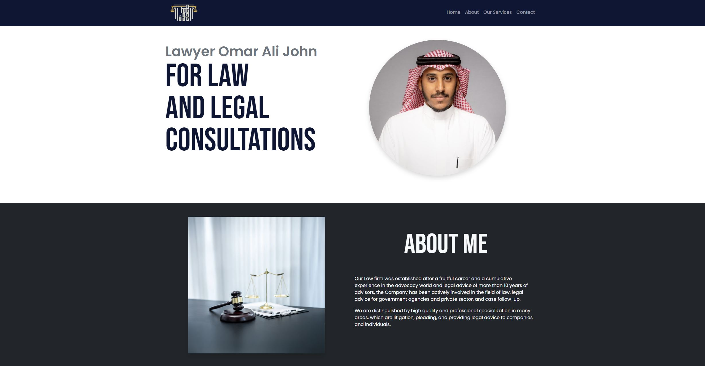
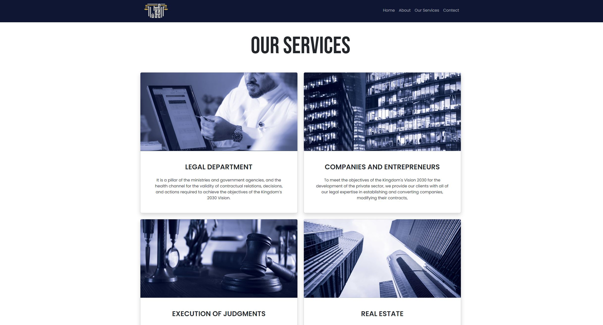
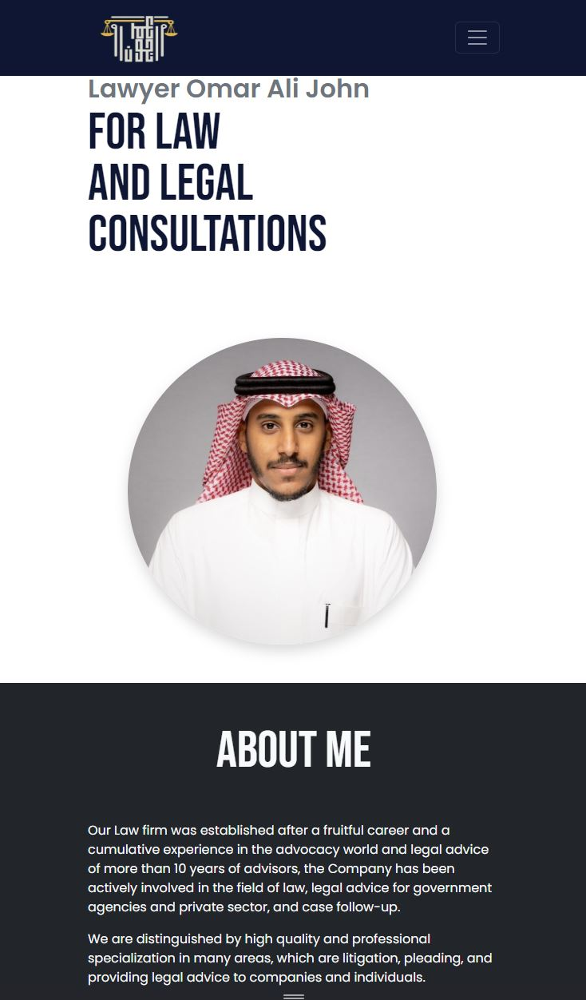
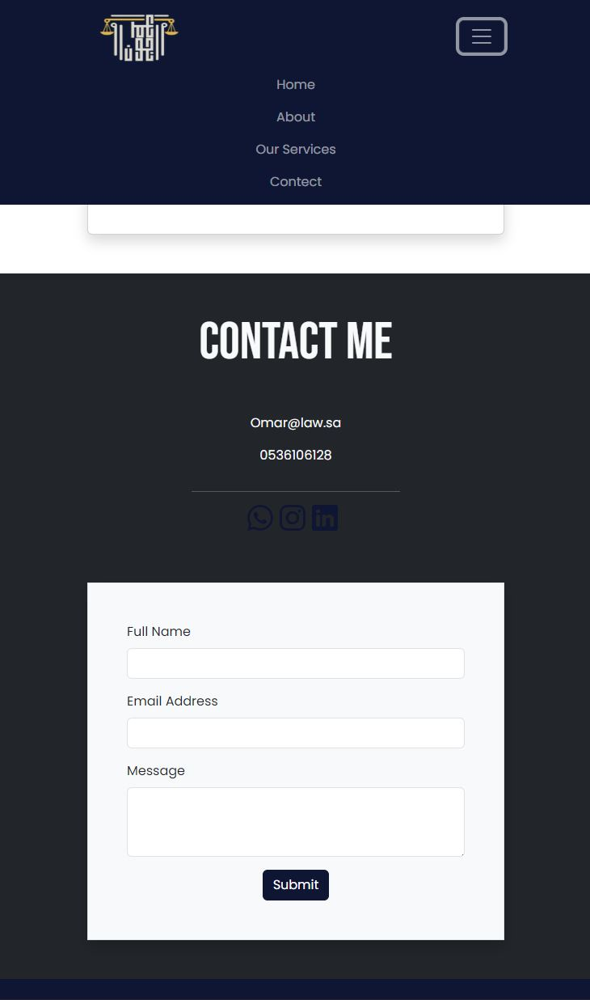

# Lawyer Omar Ali John — Legal Counsel & Advocacy

A responsive website for a practicing lawyer in Saudi Arabia, built as a client project. It presents the law firm, its services (litigation, pleading, and legal consultations for companies and individuals), and a contact form for new inquiries.

**Live site:** https://zippy-swan-9b0623.netlify.app/

## Tech Stack

- React
- Bootstrap
- Sass

## Sections

- **Header and About:** introduces the lawyer and the firm's background
- **Services:** the firm's practice areas
- **Contact:** contact details and an inquiry form

## Screenshots






## Run Locally

```bash
npm install
npm start
```

## Author

Mohammed Alawlaqi — [GitHub](https://github.com/Mohammed-M97) · [Portfolio](https://mohammed-alawlaqi.com/)
